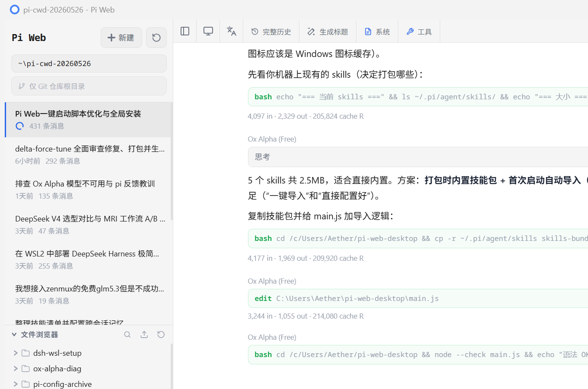

主要折腾 Windows 和 AI Agent。做些自己用得上的工具，也给常用的开源项目补功能、修问题。

### 主要项目

<table width="100%">
  <tr>
    <td width="50%" valign="top">
      <h3><a href="https://github.com/jidekaixin2dian/fps-tune">FPS 帧律</a></h3>
      
      
Windows 游戏调校，带 A/B 实测与设置还原。

      
<a href="https://github.com/jidekaixin2dian/fps-tune/releases">下载使用 →</a>

    </td>
    <td width="50%" valign="top">
      <h3><a href="https://github.com/jidekaixin2dian/piweb-desk">PiWeb Desk</a></h3>
      
      
Pi Web 桌面端，带任务通知、费用查看和全局快捷键。

      
<a href="https://github.com/jidekaixin2dian/piweb-desk/releases">下载使用 →</a>

    </td>
  </tr>
</table>

### 还有几个小工具

- **[handoff](https://github.com/jidekaixin2dian/handoff)**：换个对话，项目接着做。
- **[上下文预算](https://github.com/jidekaixin2dian/dsh-context-budget)**：管理 DSH 的 MCP 和 Skill，按需减少带进上下文的工具定义。
- **[团队插话助手](https://github.com/jidekaixin2dian/dsh-team-flow)**：主代理等队友时也能插话，结束这次等待，队友继续工作。预览版。
- **[storage-analyzer](https://github.com/jidekaixin2dian/storage-analyzer)**：基于卡兹克原版维护的 Windows 磁盘体检 skill，先看清空间占用，再决定怎么清理。

用着不顺手，或者有想法，欢迎到对应仓库提 Issue。

[个人网站](https://jidekaixin2dian.github.io/) · [全部仓库](https://github.com/jidekaixin2dian?tab=repositories)
