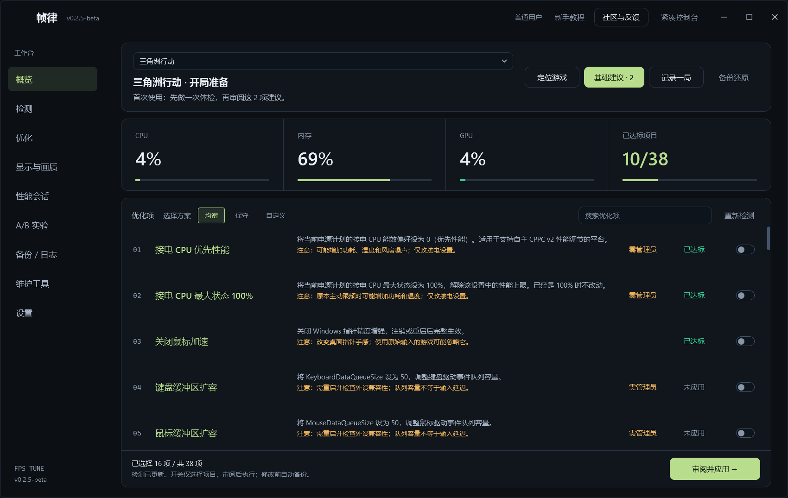
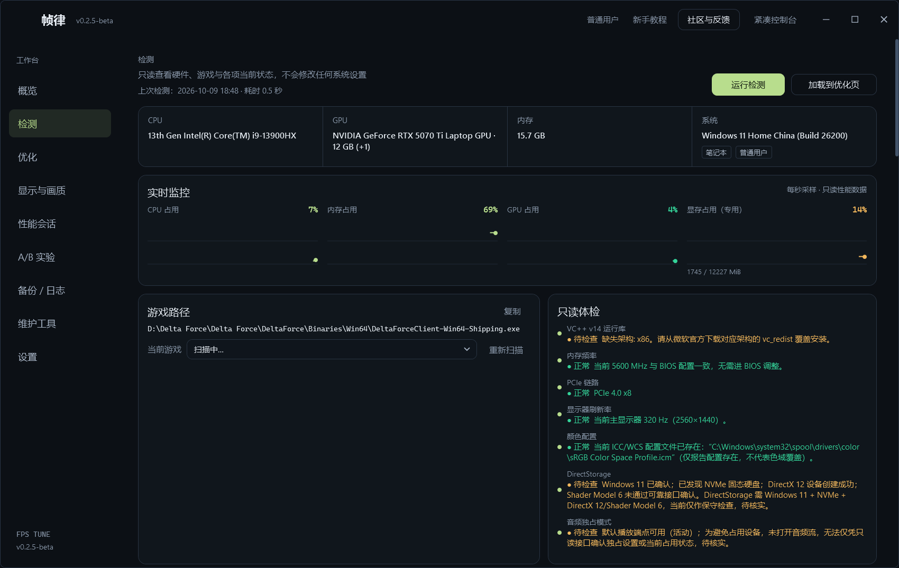
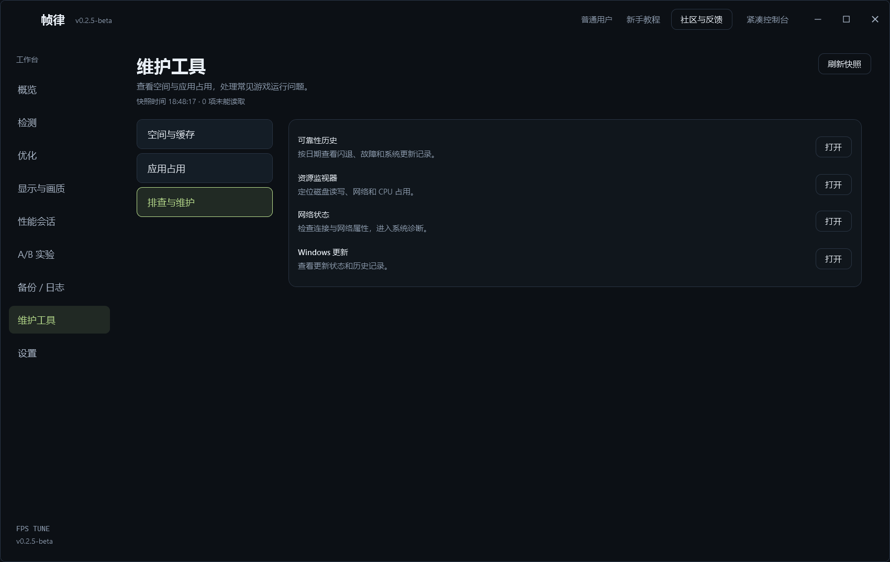

**帧律**是给 Windows 做的系统层帧率调校台。

先只读检测，再做 A/B 实测，用这台机器的结果决定哪项优化值得留。改之前自动备份，随时能还原。

<table>
  <tr>
    <td> 检测：只读体检，先看清机器状态。</td>
    <td> 维护工具：空间与系统诊断。</td>
    <td> PiWeb Desk：AI 会话的桌面壳。</td>
  </tr>
</table>

另外还在维护三个小东西：

- **handoff**：换个对话，项目接着做。
- **storage-analyzer**：Windows 磁盘体检，只读扫描加三级分诊。
- **dsh-team-flow**：让 Agent Teams 的等待先结束。

[作品实验室](https://jidekaixin2dian.github.io/) · [帧律](https://github.com/jidekaixin2dian/fps-tune) · [PiWeb Desk](https://github.com/jidekaixin2dian/piweb-desk) · [全部仓库](https://github.com/jidekaixin2dian?tab=repositories)

