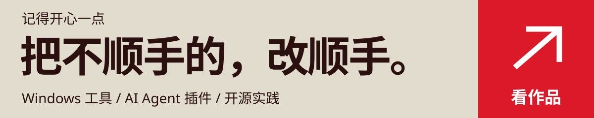

<a href="https://jidekaixin2dian.github.io/"><picture><source media="(max-width: 600px)" srcset="https://raw.githubusercontent.com/jidekaixin2dian/jidekaixin2dian/5ea908f185e2f426b833a767def38feb9d6283c3/assets/profile/cover-editorial-mobile.svg"></picture></a>

自己会用到的小工具，做出来也分享给你。

[个人网站](https://jidekaixin2dian.github.io/) · [全部仓库](https://github.com/jidekaixin2dian?tab=repositories) · [开源贡献](https://github.com/search?q=is%3Apr+author%3Ajidekaixin2dian&type=pullrequests) · [XERJ 收录](https://hub.xerj.org/contributors/jidekaixin2dian "dsh-toolgate 已被 XERJ Corpus Hub 收录")
