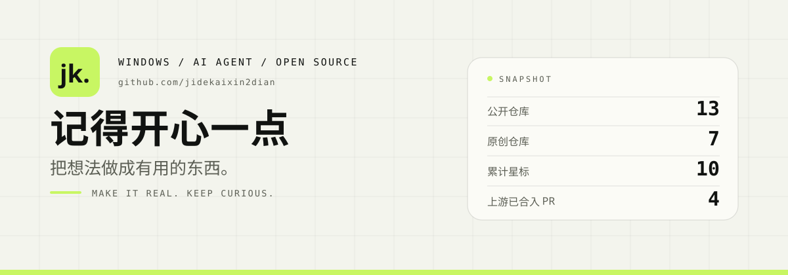

<picture>
  <source media="(prefers-color-scheme: dark)" srcset="assets/hero-dark.svg">
  
</picture>

**把想法做成有用的东西。** Windows 工具、AI Agent 工作流，以及一些开源界面上的小修补。

做之前先量，做完写清边界 —— 哪些是实测过的，哪些还没有。

### 正在做

| 项目 | 一句话 |
| :-- | :-- |
| **[FPS 帧律](https://github.com/jidekaixin2dian/fps-tune)** C# · WPF · .NET 10 | 系统层帧率调校台：先检测、再 A/B 实测，用这台机器的结果决定哪项优化值得留。 |
| **[PiWeb Desk](https://github.com/jidekaixin2dian/piweb-desk)** Electron · Node.js | 给 AI 编码会话一个桌面入口：完成通知、费用雷达、全局热键。 |
| **[handoff](https://github.com/jidekaixin2dian/handoff)** Agent Skill | 换个对话，项目接着做：先核实工作区，再交清状态与证据。 |
| **[storage-analyzer](https://github.com/jidekaixin2dian/storage-analyzer)** Python · PowerShell | Windows 磁盘体检：只读扫描、🟢🟡🔴 三级分诊、网页一键清理。 |
| **[dsh-team-flow](https://github.com/jidekaixin2dian/dsh-team-flow)** TypeScript · DSH 插件 | 让 Agent Teams 的等待先结束，队友继续跑。 |

### 给上游的补丁

| PR | 做了什么 |
| :-- | :-- |
| [pi-web #1006](https://github.com/agegr/pi-web/pull/1006) | 模型发现端点从 provider catalog 解析，不再靠单一假设。 |
| [pi-web #1050](https://github.com/agegr/pi-web/pull/1050) | models-only provider 保留 catalog 里的 API 协议。 |
| [dsh-codex-ui #33](https://github.com/MichengAI/dsh-codex-ui/pull/33) | 发送键改用按钮语义色，皮肤换色后不再是「黑圆 + 没箭头」。 |
| [awesome-dsh-plugin #7497](https://github.com/awesome-dsh-plugin/awesome-dsh-plugin/pull/7497) | 收录 dsh-team-flow。 |

### 做事的方式

- **先量，再说。** 优化有没有用，让实测结果回答，不承诺固定的帧率提升。
- **写清边界。** 哪些是我做的、哪些来自上游、哪些还没验证，都写在项目里。
- **做完才算数。** 从检测、解释、确认，到执行、还原、导出报告，走完整条链路。

 

  
    <a href="https://jidekaixin2dian.github.io/">作品实验室</a>
    ·
    <a href="https://github.com/jidekaixin2dian?tab=repositories">全部仓库</a>
    ·
    KEEP CURIOUS. KEEP BUILDING.
  

